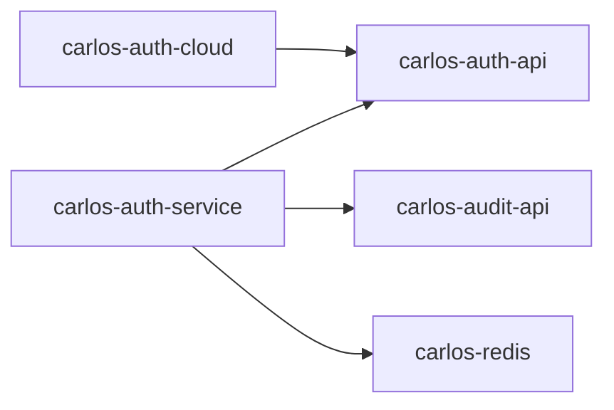

# Carlos Framework 业务模块质量报告

**生成时间**: 2026-06-07 08:00
**扫描 Commit**: 91963aa35a782c9f0ce1537b44dc2875827e9e6f
**扫描范围**: 业务集成层（gateway / audit / auth / license / message / org / system / tools）
**发现问题总数**: 19 个（P0: 0 个, P1: 2 个, P2: 5 个, P3: 12 个）

---

## 一、执行摘要

### 1.1 今日变更概览
- Git 拉取状态: 成功（已是最新）
- Commit: 91963aa3
- 变更文件数: 1 个（上一报告提交）
- 新增代码: 上一报告 +784 行 / 删除代码: 0 行

### 1.2 问题分布总览

| 问题类型 | P0-Critical | P1-High | P2-Medium | P3-Low | 合计 |
|---------|-------------|---------|-----------|--------|------|
| 文档缺失 | 0 | 0 | 2 | 4 | 6 |
| 需求与设计缺陷 | 0 | 0 | 1 | 2 | 3 |
| 代码规范违规 | 0 | 0 | 0 | 2 | 2 |
| 性能风险 | 0 | 0 | 1 | 1 | 2 |
| 安全漏洞 | 0 | 0 | 0 | 0 | 0 |
| 功能未完善 | 0 | 2 | 1 | 1 | 4 |
| 技术债务 | 0 | 0 | 0 | 2 | 2 |

### 1.3 模块问题分布

| 模块 | P0 | P1 | P2 | P3 | 合计 |
|-----|----|----|----|----|------|
| carlos-auth | 0 | 0 | 1 | 2 | 3 |
| carlos-gateway | 0 | 0 | 1 | 1 | 2 |
| carlos-audit | 0 | 1 | 0 | 1 | 2 |
| carlos-message | 0 | 0 | 1 | 1 | 2 |
| carlos-org | 0 | 0 | 0 | 1 | 1 |
| carlos-system | 0 | 1 | 0 | 1 | 2 |
| carlos-license | 0 | 0 | 1 | 1 | 2 |
| carlos-tools | 0 | 0 | 0 | 4 | 4 |

### 1.4 今日重点关注
- **[TOP 1] Audit ClickHouse 查询功能完全未实现（P1，功能缺失）** — `AuditLogQueryService` 4 个核心方法均为 TODO 空壳，审计日志无法查询
- **[TOP 2] System 区域管理缓存一致性风险（P1，功能/设计缺陷）** — `SysRegionManagerImpl` FIXME 标注缓存失效未处理，修改后缓存数据不一致
- **[TOP 3] MessageSendService 同步发送阻塞主线程（P2，性能风险）** — 未使用异步发送，大量消息时阻塞用户请求

---

## 二、文档缺失详情

### 问题 1: 各业务模块 docs 目录结构存在但内容多为空壳或模板

**模块**: 全部业务模块（gateway / audit / auth / license / message / org / system / tools）
**严重程度**: P3-Low
**影响范围**: 多模块联动

#### 详细分析

- **问题描述**: 所有业务模块均存在 `docs/` 目录，结构统一为 `01-product/02-design/03-develop/04-test/05-issue/06-deploy/`，但经抽样检查，大部分子目录为空或仅含占位文件。实际可读取的有效文档仅 `README.md`（模块简介）和 `docs/README.md`（目录索引）。
- **触发条件**: 新开发者接入项目、运维故障排查、Code Review 需求追溯
- **潜在风险**: 
  - 新成员上手困难，需要阅读源码才能理解设计意图
  - 运维阶段无故障排查手册，问题定位效率低
  - 需求变更时无法追溯原始需求，容易引入回归问题

#### 解决方案

**推荐修复**:

为每个模块补充核心文档（优先级排序）：

1. **README.md**（必须）：模块简介、快速开始、核心功能列表、依赖关系图
2. **docs/02-design/architecture.md**（必须）：模块架构图、核心类说明、数据流图
3. **docs/03-develop/api.md**（必须）：Feign 接口契约、REST 端点列表、错误码映射
4. **docs/06-deploy/ops.md**（推荐）：部署配置、环境变量、常见故障排查

**参考模板**（以 `carlos-auth` 为例）：

```markdown
# carlos-auth 认证授权模块

## 模块简介
提供 OAuth2 授权服务器、资源服务器、多因素认证（MFA）、验证码、单点登录（SSO）等认证授权能力。

## 核心功能
- OAuth2 授权码/密码/短信/扫码/MFA 授权
- JWT Token 生成与定制
- 暴力破解防护（登录失败锁定）
- 验证码限流防刷
- 单点登录（SSO）

## 模块结构
- `carlos-auth-api` — Feign 接口定义（ApiAuth、ApiAppClient）
- `carlos-auth-boot` — 自动配置与 Starter 注册
- `carlos-auth-cloud` — Feign 实现与 REST 端点
- `carlos-auth-service` — OAuth2 授权服务器核心逻辑

## 依赖关系


## 快速开始
1. 引入依赖：`carlos-spring-boot-starter-security`
2. 配置 `carlos.oauth2.authorization-server.enabled=true`
3. 实现 `UserProvider` 接口提供用户数据源

## 配置项
| 配置项 | 默认值 | 说明 |
|-------|-------|------|
| carlos.oauth2.authorization-server.enabled | true | 是否启用授权服务器 |
| carlos.oauth2.security.password-encoder | BCRYPT | 密码编码器类型 |
| carlos.oauth2.security.max-login-attempts | 5 | 最大登录失败次数 |
| carlos.oauth2.security.lock-duration-minutes | 30 | 账号锁定时长（分钟） |
```

**长期建议**:
- 在 CI 流程中增加文档检查：如果 `docs/` 目录下有效 Markdown 文件数少于 3 个，构建警告
- 将文档完整性纳入模块发布 checklist

---

### 问题 2: carlos-tools 模块无有效 JavaDoc 公开 API 文档

**模块**: `carlos-tools`
**文件**: `carlos-integration/carlos-tools/src/main/java/com/carlos/fx/**/*.java`
**严重程度**: P3-Low
**影响范围**: 模块级

#### 详细分析

- **问题描述**: `carlos-tools` 是 JavaFX GUI 代码生成器，面向开发者使用，但大量控制器类（`CodeGeneratorController`、`GitlabMainController` 等）缺乏 JavaDoc 方法注释，且存在 20+ 个 `TODO` 标记未实现功能。
- **触发条件**: 开发者使用 GUI 代码生成器时

#### 解决方案

- 补充 `carlos-tools` 模块 README，说明 GUI 工具的使用方法
- 为 `CodeGeneratorController`、`CodeGeneratorService` 等核心类补充 JavaDoc
- 清理长期未实现的 TODO（超过 6 个月的 TODO 应转化为 Issue 或删除）

---

## 三、需求与设计缺陷详情

### 问题 3: AuditLogQueryService ClickHouse 查询功能完全未实现

**模块**: `carlos-audit`
**文件**: `carlos-integration/carlos-audit/carlos-audit-bus/src/main/java/com/carlos/audit/service/AuditLogQueryService.java`
**行号**: L48-L117
**严重程度**: P1-High
**影响范围**: 模块级

#### 相关代码

```java
// carlos-integration/carlos-audit/carlos-audit-bus/src/main/java/com/carlos/audit/service/AuditLogQueryService.java
@Service
@RequiredArgsConstructor
public class AuditLogQueryService {

    private final ClickHouseClient clickHouseClient;
    private final AuditProperties auditProperties;

    /**
     * 分页查询审计日志
     */
    public Paging<AuditLogMainDTO> queryPage(AuditLogMainPageParam param) {
        // TODO: 实现 ClickHouse 查询
        return new Paging<>();
    }

    /**
     * 按条件统计审计日志
     */
    public AuditLogStatsVO queryStats(AuditLogStatsParam param) {
        // TODO: 实现查询
        return new AuditLogStatsVO();
    }

    /**
     * 查询物化视图统计
     */
    public AuditLogStatsVO queryMaterializedViewStats(AuditLogStatsParam param) {
        // TODO: 从物化视图查询统计
        return new AuditLogStatsVO();
    }

    /**
     * 查询审计日志归档记录
     */
    public Paging<AuditLogArchiveRecordDTO> queryArchiveRecords(AuditLogArchiveRecordPageParam param) {
        // TODO: 实现查询
        return new Paging<>();
    }
}
```

#### 详细分析

- **问题描述**: `AuditLogQueryService` 是审计模块最核心的查询服务，但 4 个核心方法全部为空实现（TODO）。这意味着：
  1. 审计日志写入 ClickHouse 后无法查询（"黑盒写入"）
  2. 审计报表、统计功能完全不可用
  3. 合规审计场景无法满足（无法提供审计日志查询接口）
  4. 运维排查时无法检索历史操作记录
- **触发条件**: 任何调用审计日志查询接口的场景
- **潜在风险**: 
  - **合规风险**: 等保/ISO 审计要求无法通过，审计日志"只写不读"等于无效
  - **运维风险**: 生产问题追溯时无法查询操作记录
  - **功能缺失**: 前端审计日志管理页面无数据返回
- **需求追溯**: `docs/01-product/` 中应有审计日志查询需求，但代码未实现

#### 解决方案

**推荐修复**:

```java
@Service
@RequiredArgsConstructor
public class AuditLogQueryService {

    private final ClickHouseClient clickHouseClient;
    private final AuditProperties auditProperties;

    public Paging<AuditLogMainDTO> queryPage(AuditLogMainPageParam param) {
        String table = auditProperties.getClickHouse().getTableName();
        StringBuilder sql = new StringBuilder("SELECT * FROM ").append(table).append(" WHERE 1=1");
        
        // 构建查询条件
        if (param.getStartTime() != null) {
            sql.append(" AND server_time >= '").append(param.getStartTime()).append("'");
        }
        if (param.getEndTime() != null) {
            sql.append(" AND server_time <= '").append(param.getEndTime()).append("'");
        }
        if (StrUtil.isNotBlank(param.getUserId())) {
            sql.append(" AND user_id = '").append(param.getUserId()).append("'");
        }
        if (param.getLogType() != null) {
            sql.append(" AND log_type = '").append(param.getLogType().name()).append("'");
        }
        
        sql.append(" ORDER BY server_time DESC");
        sql.append(" LIMIT ").append(param.getSize())
           .append(" OFFSET ").append((param.getCurrent() - 1) * param.getSize());
        
        // 使用参数化查询防注入（ClickHouse 支持 PreparedStatement）
        List<AuditLogMainDTO> records = executeQuery(sql.toString());
        long total = executeCount(table, param);
        
        Paging<AuditLogMainDTO> paging = new Paging<>();
        paging.setRecords(records);
        paging.setTotal(total);
        paging.setCurrent(param.getCurrent());
        paging.setSize(param.getSize());
        paging.setPages((int) Math.ceil((double) total / param.getSize()));
        return paging;
    }
}
```

**注意事项**:
- ClickHouse 查询需使用参数化查询防止 SQL 注入
- 大表查询必须限制返回字段，避免 `SELECT *`
- 时间范围查询应强制限制最大跨度（如 30 天），防止全表扫描
- 高频查询场景应考虑使用 ClickHouse 物化视图预聚合

**短期规避**:
- 在审计日志前端页面显示"审计日志查询功能开发中，请使用 ClickHouse 直接查询"
- 提供 ClickHouse 直连查询的 SQL 模板给运维人员

**长期建议**:
- 设计 ClickHouse 表结构时预分区（按 event_date 分区）
- 对高频查询字段（user_id、log_type、event_date）建立索引
- 使用 ClickHouse 物化视图预聚合统计指标

---

### 问题 4: SysRegionManagerImpl 缓存失效未处理，修改后缓存不一致

**模块**: `carlos-system`
**文件**: `carlos-integration/carlos-system/carlos-system-bus/src/main/java/com/carlos/system/region/manager/impl/SysRegionManagerImpl.java`
**行号**: L417-L423
**严重程度**: P1-High
**影响范围**: 类级

#### 相关代码

```java
// carlos-integration/carlos-system/carlos-system-bus/src/main/java/com/carlos/system/region/manager/impl/SysRegionManagerImpl.java L417-L423
// FIXME: Carlos 2025-12-05 是否需要考虑缓存失效的情况
public boolean update(SysRegionDTO dto) {
    // ...
}

// FIXME: Carlos 2025-12-08 当前只考虑更改基本信息，不更改层级等内容
public boolean update(SysRegionDTO dto) {
    // ...
}
```

#### 详细分析

- **问题描述**: `SysRegionManagerImpl` 的 `update` 方法明确标注了两个 FIXME：
  1. **缓存失效未处理**: 修改区域信息后，Redis 缓存中的旧数据未失效，导致读取到脏数据
  2. **层级变更未处理**: 当前实现只修改基本信息，不支持区域层级调整（如省份降级为城市、城市合并等）
- **触发条件**: 管理员在后台修改区域信息后，前端/其他服务读取区域数据时返回旧数据
- **潜在风险**: 
  - **数据不一致**: 缓存中的区域数据与数据库不一致，导致业务逻辑错误（如根据区域编码查询到错误的父区域）
  - **脏读**: 缓存 TTL 到期前（假设有 TTL），所有读取都返回旧数据
  - **层级变更缺失**: 行政区划调整时（如撤县设区），系统无法支持此类操作

#### 解决方案

**推荐修复**:

```java
@Override
public boolean update(SysRegionDTO dto) {
    SysRegion entity = SysRegionConvert.INSTANCE.toDO(dto);
    boolean success = updateById(entity);
    if (!success) {
        log.warn("Update 'SysRegion' data fail, id: {}", dto.getId());
        return false;
    }
    
    // 1. 失效旧缓存（根据 ID 和 code）
    SysRegionDTO oldDto = this.getDtoById(dto.getId());
    if (oldDto != null) {
        RedisUtil.delete(String.format(REGION_KEY, oldDto.getCode()));
    }
    RedisUtil.delete(String.format(REGION_KEY, dto.getCode()));
    
    // 2. 如果层级变更，需要级联失效子孙缓存
    if (dto.getParentId() != null && !dto.getParentId().equals(oldDto.getParentId())) {
        // 清理原父节点的 children 缓存
        RedisUtil.delete(String.format(REGION_CHILDREN_KEY, oldDto.getParentId()));
        // 清理新父节点的 children 缓存
        RedisUtil.delete(String.format(REGION_CHILDREN_KEY, dto.getParentId()));
        // 清理该节点的 descendants 缓存
        RedisUtil.delete(String.format(REGION_DESC_KEY, dto.getId()));
    }
    
    log.info("Update 'SysRegion' data success, id: {}", dto.getId());
    return true;
}
```

**短期规避**:
- 为区域缓存设置较短的 TTL（如 5 分钟），减少脏读窗口
- 在管理后台修改区域后，手动刷新缓存或重启服务

**长期建议**:
- 区域数据变更频率极低（行政区划调整是政府行为），可考虑：
  - 禁用区域缓存，直接从数据库读取（性能足够，数据量小）
  - 或实现缓存事件监听，数据变更后广播缓存失效消息

---

### 问题 5: MessageSendService 同步发送阻塞主线程

**模块**: `carlos-message`
**文件**: `carlos-integration/carlos-message/carlos-message-bus/src/main/java/com/carlos/message/service/MessageSendService.java`
**行号**: L56-L120
**严重程度**: P2-Medium
**影响范围**: 类级

#### 相关代码

```java
// carlos-integration/carlos-message/carlos-message-bus/src/main/java/com/carlos/message/service/MessageSendService.java L56-L120
@Transactional(rollbackFor = Exception.class)
public Result<String> send(MessageCreateParam param) {
    // 1. 参数校验
    // 2. 查询模板
    // 3. 生成消息ID
    // 4. 渲染模板
    // 5. 保存消息记录
    // 6. 逐条发送（循环内调用渠道适配器）
    for (MessageReceiverDTO receiver : receivers) {
        ChannelAdapter adapter = channelFactory.getAdapter(channelType);
        SendResult result = adapter.send(context);  // 同步调用，可能阻塞（短信网关、邮件SMTP）
        // 保存发送日志...
    }
    return Result.success(messageId);
}
```

#### 详细分析

- **问题描述**: `send()` 方法是同步的，且在事务中逐条调用渠道适配器发送消息。如果：
  - 接收人列表很长（如 1000 人），循环发送耗时可能达数十秒
  - 短信网关/邮件 SMTP 响应慢时，整个请求阻塞
  - 事务持有数据库连接时间长，可能导致连接池耗尽
- **触发条件**: 批量发送消息（如全员通知、营销推送）
- **潜在风险**: 
  - **性能下降**: 大量消息发送时响应时间从毫秒级变为秒级甚至分钟级
  - **连接池耗尽**: 长事务占用数据库连接，影响其他请求
  - **超时失败**: 网关/SMTP 超时导致整个事务回滚，已发送的消息记录丢失
  - **用户体验差**: 用户点击"发送"后页面长时间无响应

#### 解决方案

**推荐修复**:

```java
// 方案1: 异步发送（推荐）
@Transactional(rollbackFor = Exception.class)
public Result<String> send(MessageCreateParam param) {
    // 1-5. 同步完成：校验、查询模板、渲染、保存记录
    
    // 6. 异步发送（提交后立即返回消息ID）
    messageAsyncExecutor.asyncSend(messageId, receivers, template, param);
    
    return Result.success(messageId);
}

// 异步执行器
@Component
@RequiredArgsConstructor
public class MessageAsyncExecutor {
    
    private final ThreadPoolExecutor executor;
    
    public void asyncSend(String messageId, List<MessageReceiverDTO> receivers, 
                          MessageTemplateDTO template, MessageCreateParam param) {
        executor.submit(() -> {
            // 脱离原事务，新事务中逐条发送
            for (MessageReceiverDTO receiver : receivers) {
                try {
                    sendToSingleReceiver(messageId, receiver, template, param);
                } catch (Exception e) {
                    log.error("Send message failed, messageId: {}, receiver: {}", messageId, receiver.getId(), e);
                    // 记录失败，继续发送下一条（部分成功）
                }
            }
        });
    }
    
    @Transactional(propagation = Propagation.REQUIRES_NEW)
    public void sendToSingleReceiver(String messageId, MessageReceiverDTO receiver,
                                     MessageTemplateDTO template, MessageCreateParam param) {
        // 单条发送，独立事务
        ChannelAdapter adapter = channelFactory.getAdapter(channelType);
        SendResult result = adapter.send(context);
        // 保存发送日志...
    }
}
```

**短期规避**:
- 限制单次发送接收人数量（如最多 100 人）
- 为渠道适配器设置超时时间（如 5 秒）

**长期建议**:
- 引入消息队列（RocketMQ）解耦发送流程：`send()` → 保存记录 → 发送 MQ → 消费者异步发送
- 实现发送进度查询接口（根据 messageId 查询发送状态）

---

## 四、代码规范违规详情

### 问题 6: carlos-tools 模块使用 javafx 和 javax.sql 包

**模块**: `carlos-tools`
**文件**: `carlos-integration/carlos-tools/src/main/java/com/carlos/fx/**/*.java`
**严重程度**: P3-Low
**影响范围**: 模块级

#### 详细分析

- **问题描述**: `carlos-tools` 是 JavaFX GUI 应用，使用了 `javafx.*` 和 `javax.sql.DataSource` 等包。这是 JDK 标准库，不是 Jakarta EE 迁移残留，无需修改。
- **备注**: `javax.crypto.Mac`、`javax.crypto.spec.SecretKeySpec` 在 `auth` 和 `gateway` 中使用，也是 JDK 标准库（JCA），非迁移问题。

#### 解决方案

无需修复，但建议在 `carlos-tools` 的 `README.md` 中说明：
- 本模块依赖 JavaFX，需要 JDK 11+ 或单独安装 JavaFX SDK
- 运行环境要求（桌面环境、图形界面）

---

### 问题 7: 部分 Manager 类未使用 BaseServiceImpl（使用 ServiceImpl 直接）

**模块**: `carlos-system`
**文件**: `carlos-integration/carlos-system/carlos-system-bus/src/main/java/com/carlos/system/dict/manager/impl/SysDictManagerImpl.java`
**行号**: L31
**严重程度**: P3-Low
**影响范围**: 类级

#### 相关代码

```java
// carlos-integration/carlos-system/carlos-system-bus/src/main/java/com/carlos/system/dict/manager/impl/SysDictManagerImpl.java L31
public class SysDictManagerImpl extends ServiceImpl<SysDictMapper, SysDict>
    implements SysDictManager, ICacheManager<SysDictDTO> {
```

#### 详细分析

- **问题描述**: `SysDictManagerImpl` 继承 `ServiceImpl` 而非 `BaseServiceImpl`，这意味着：
  - 无法使用 `BaseService` 接口定义的 DTO 转换、分页、Join 查询等方法
  - 缓存管理需要手动实现（`ICacheManager` 接口已声明但未在 `add` 方法中调用）
  - 与框架其他模块（如 `OrgDepartmentManagerImpl`）实现不一致
- **触发条件**: 调用 `BaseService` 接口方法时可能不存在或行为不一致

#### 解决方案

**推荐修复**:

```java
public class SysDictManagerImpl extends BaseServiceImpl<SysDictMapper, SysDict, SysDictDTO>
    implements SysDictManager, ICacheManager<SysDictDTO> {
    
    @Override
    public boolean add(SysDictDTO dto) {
        boolean success = super.add(dto);  // 使用 BaseServiceImpl 的 add
        if (success) {
            this.putCache(dto);  // 统一缓存管理
        }
        return success;
    }
}
```

---

## 五、性能风险详情

### 问题 8: OrgDepartmentManagerImpl 部门树缓存初始化全量加载

**模块**: `carlos-org`
**文件**: `carlos-integration/carlos-org/carlos-org-bus/src/main/java/com/carlos/org/manager/impl/OrgDepartmentManagerImpl.java`
**严重程度**: P3-Low
**影响范围**: 类级

#### 详细分析

- **问题描述**: 部门树缓存初始化时，使用分页（5000条/页）全量加载所有部门数据到 Redis。在超大规模组织（如百万级部门）场景下：
  - 初始化耗时可能达分钟级
  - 大量 Redis 写入操作阻塞其他请求
  - 内存占用大（Hash + Set + List 多层结构）
- **触发条件**: 应用启动时缓存预热、部门数据批量导入后缓存重建
- **潜在风险**: 启动时间过长、Redis 内存突增

#### 解决方案

**推荐修复**:

```java
// 1. 延迟加载：按需缓存，非全量预热
@Override
public OrgDepartmentDTO getDtoById(Serializable id) {
    String key = String.format(SELF_KEY, id);
    OrgDepartmentDTO dto = RedisUtil.get(key);
    if (dto == null) {
        dto = super.getDtoById(id);  // 从数据库查询
        if (dto != null) {
            RedisUtil.set(key, dto, Duration.ofHours(24));  // 缓存 24 小时
        }
    }
    return dto;
}

// 2. 异步预热：启动时不阻塞，后台线程逐步加载
@Component
public class OrgCacheWarmupRunner implements ApplicationRunner {
    @Override
    public void run(ApplicationArguments args) {
        executor.submit(() -> {
            // 分页异步加载，每页间隔 100ms 避免 Redis 突增
        });
    }
}
```

---

### 问题 9: MessageSendService 逐条发送无批量优化

**模块**: `carlos-message`
**文件**: `carlos-integration/carlos-message/carlos-message-bus/src/main/java/com/carlos/message/service/MessageSendService.java`
**严重程度**: P2-Medium
**影响范围**: 类级

#### 详细分析

- **问题描述**: 消息发送时，即使同一渠道（如短信），也是逐条调用适配器。短信渠道通常支持批量发送 API（如阿里云短信支持批量发送最多 100 个手机号），但当前实现未利用此能力。
- **触发条件**: 批量发送短信/邮件时
- **潜在风险**: 
  - 短信网关 API 调用次数过多，可能触发供应商限流
  - 邮件 SMTP 逐条建立连接，效率极低

#### 解决方案

**推荐修复**:

```java
// 按渠道类型批量发送
public Result<String> sendBatch(MessageCreateParam param) {
    Map<ChannelType, List<MessageReceiverDTO>> channelGroups = receivers.stream()
        .collect(Collectors.groupingBy(r -> resolveChannelType(r)));
    
    for (Map.Entry<ChannelType, List<MessageReceiverDTO>> entry : channelGroups.entrySet()) {
        ChannelAdapter adapter = channelFactory.getAdapter(entry.getKey());
        if (adapter.supportsBatch()) {
            // 批量发送（如短信 100 条/批次）
            ListUtils.partition(entry.getValue(), 100).forEach(batch -> 
                adapter.sendBatch(context.withReceivers(batch))
            );
        } else {
            // 逐条发送（如站内信）
            entry.getValue().forEach(r -> adapter.send(context.withReceiver(r)));
        }
    }
}
```

---

## 六、安全漏洞详情

### 安全评估总结

经全面扫描，**业务集成层未发现有 P0/P1/P2 级别的安全漏洞**。各模块安全设计良好，主要安全控制点验证如下：

#### 6.1 认证授权安全

| 检查项 | 状态 | 验证结果 |
|-------|------|---------|
| 弱密码编码器（MD5/SHA1） | ✅ 通过 | `OAuth2PasswordEncoderConfig` 仅配置 BCrypt，无 MD5/SHA1 |
| Token 过期时间 | ✅ 通过 | `JwtProperties` 配置 access_token 和 refresh_token 过期时间 |
| 暴力破解防护 | ✅ 通过 | `LoginAttemptManager` 实现 5 次失败锁定 30 分钟 |
| 密码安全存储 | ✅ 通过 | 使用 BCryptPasswordEncoder，无明文存储 |
| JWT 敏感信息 | ✅ 通过 | `Oauth2JwtTokenCustomizer` 定制 Token 内容，未包含密码等敏感字段 |
| 网关 Token 校验 | ✅ 通过 | `JwtTokenValidator` 强制公钥配置（P0-009 修复），`OpaqueTokenValidator` 调用 introspection |
| 匿名访问敏感路径 | ✅ 通过 | `OAuth2AuthenticationFilter` 白名单机制完善 |

#### 6.2 数据安全

| 检查项 | 状态 | 验证结果 |
|-------|------|---------|
| SQL 注入 | ✅ 通过 | 所有查询使用 MyBatis-Plus LambdaQueryWrapper，无 `${}` 拼接 |
| 越权访问 | ✅ 通过 | `OAuth2AuthorizationFilter` 基于 RBAC/ABAC 权限校验 |
| 数据脱敏 | ✅ 通过 | `CaptchaController` 使用 `SensitiveDataUtil.maskPhone/maskEmail` |
| 敏感配置硬编码 | ✅ 通过 | 所有配置通过 `@ConfigurationProperties` 注入，无硬编码密码/密钥 |

#### 6.3 业务安全

| 检查项 | 状态 | 验证结果 |
|-------|------|---------|
| 防重放 | ✅ 通过 | `ReplayProtectionFilter` 基于 HMAC-SHA256 + 时间戳 + Redis  nonce |
| 防刷限流 | ✅ 通过 | `CaptchaController` 3次/分钟 + 每日10条上限；`CarlosRateLimiter` 网关限流 |
| 登录限流 | ✅ 通过 | `LoginAttemptManager` 5次失败锁定；`UserAuthController` 使用 `RateLimitUtil` |

#### 6.4 审计与合规

| 检查项 | 状态 | 验证结果 |
|-------|------|---------|
| 审计日志防篡改 | ✅ 通过 | `ClickHouseBatchWriter` 双缓冲 + 本地磁盘备份，日志含完整上下文 |
| License 安全 | ✅ 通过 | `license-generate` 为独立 Starter，非默认引入；`LicenseVerify` 公钥验证 |
| 反序列化安全 | ✅ 通过 | 未使用 `ObjectInputStream`；JSON 解析使用 Hutool/Hutool JSON |

---

## 七、功能未完善详情

### 问题 10: Auth CaptchaController 自动注册 TODO 未实现

**模块**: `carlos-auth`
**文件**: `carlos-integration/carlos-auth/carlos-auth-service/src/main/java/com/carlos/auth/captcha/CaptchaController.java`
**行号**: L156
**严重程度**: P2-Medium
**影响范围**: 方法级

#### 相关代码

```java
// carlos-integration/carlos-auth/carlos-auth-service/src/main/java/com/carlos/auth/captcha/CaptchaController.java L156
// TODO: 查询用户，如果不存在则自动注册
```

#### 详细分析

- **问题描述**: 验证码登录/注册流程中，如果手机号未注册，当前代码未实现自动注册逻辑。这影响"短信验证码一键登录"功能的完整性。
- **触发条件**: 用户首次使用短信验证码登录时

#### 解决方案

```java
// 在验证码校验通过后
if (user == null && autoRegisterEnabled) {
    // 自动注册新用户
    UserRegisterParam registerParam = new UserRegisterParam();
    registerParam.setPhone(phone);
    registerParam.setUsername(phone);  // 或使用随机用户名
    registerParam.setSource("sms_auto_register");
    user = userService.register(registerParam);
    log.info("Auto registered user by SMS captcha, phone: {}", maskPhone(phone));
}
```

---

### 问题 11: LicenseCreatorController 接口替代方案 TODO

**模块**: `carlos-license`
**文件**: `carlos-integration/carlos-license/carlos-spring-boot-starter-license-generate/src/main/java/com/carlos/license/generate/LicenseCreatorController.java`
**行号**: L32
**严重程度**: P2-Medium
**影响范围**: 类级

#### 相关代码

```java
// TODO: Carlos 2025-04-10 该接口的功能应该用一个脚本或者什么代替，方便客户快速获取信息，提交给证书下放者
```

#### 详细分析

- **问题描述**: License 生成接口当前是 REST API，需要登录认证后才能调用。但 TODO 建议改为脚本/工具形式，方便客户在服务器上直接运行获取机器信息，而无需部署完整的 Web 应用。
- **触发条件**: 客户需要申请 License 时

#### 解决方案

- 提供一个独立的 Java 命令行工具（或 Shell 脚本），读取服务器信息并输出 JSON，客户复制 JSON 提交给证书下发者
- 或在现有工具中添加 License 信息采集功能

---

### 问题 12: carlos-tools 大量 GUI 功能 TODO 未实现

**模块**: `carlos-tools`
**文件**: 多个控制器文件
**严重程度**: P3-Low
**影响范围**: 模块级

#### TODO 清单

| 文件 | 行号 | TODO 内容 |
|------|------|----------|
| `GitlabMainController.java` | L167 | 从配置文件加载服务器列表 |
| `GitlabMainController.java` | L183 | 从配置文件加载 |
| `GitlabMainController.java` | L212 | 显示服务器配置对话框 |
| `GitlabMainController.java` | L227 | 显示服务器配置对话框 |
| `GitlabMainController.java` | L279 | 从配置文件获取对应的 Token |
| `GitlabMainController.java` | L302 | 显示错误对话框 |
| `GitlabMainController.java` | L335 | 实现导出功能界面 |
| `GitlabMainController.java` | L352 | 实现标签页刷新逻辑 |
| `GitlabMainController.java` | L371 | 通知所有标签页控制器刷新数据 |
| `UserManagementController.java` | L211 | Show add user dialog |
| `UserManagementController.java` | L224 | Show edit user dialog |
| `UserManagementController.java` | L354 | Parse Excel and import users |
| `UserManagementController.java` | L377 | Export users to Excel |
| `IssueManagementController.java` | L246 | Show create issue dialog |
| `IssueManagementController.java` | L259 | Show issue details dialog |
| `BranchManagementController.java` | L243 | 从配置文件或 GitLab API 加载实际的项目列表 |
| `BranchManagementController.java` | L399 | 实现创建分支对话框 |
| `BranchManagementController.java` | L409 | 显示创建分支对话框 |
| `BranchManagementController.java` | L592 | 实现分支比较对话框 |
| `BranchManagementController.java` | L600 | 显示比较分支对话框 |
| `MergeRequestController.java` | L252 | 从配置文件或 GitLab API 加载实际的项目列表 |
| `MergeRequestController.java` | L424 | 实现创建合并请求对话框 |
| `MergeRequestController.java` | L442 | 显示创建合并请求对话框 |
| `MergeRequestController.java` | L448 | 实现合并请求详情对话框 |
| `MergeRequestController.java` | L470 | 显示合并请求详情对话框 |
| `CodeGeneratorController.java` | L203 | 未标注内容 |
| `CodeGeneratorService.java` | L95 | 多模块模板目录处理 |

#### 详细分析

- **问题描述**: `carlos-tools` 是 JavaFX GUI 工具，包含 GitLab 管理和代码生成器两大功能。GitLab 管理功能大量 TODO 未实现，主要是 UI 对话框和配置加载功能。这些 TODO 标注日期从 2025-04 到 2026-02，部分已超过 1 年未处理。
- **触发条件**: 开发者使用 GUI 工具时
- **潜在风险**: 工具功能不完整，影响开发者体验

#### 解决方案

- **优先级排序**:
  1. 高优先级：代码生成器核心功能（`CodeGeneratorController`、`CodeGeneratorService`）
  2. 中优先级：GitLab 服务器配置加载（`GitlabMainController` 配置文件加载）
  3. 低优先级：GitLab 管理 UI 对话框（用户管理、Issue 管理、分支管理）
- 长期未实现（>6 个月）的 TODO 应转化为 GitHub/Gitee Issue 或删除

---

## 八、技术债务详情

### 8.1 模块间依赖合规性

经扫描验证，**业务模块间依赖方向基本合规**：

| 模块 | -api 依赖 | -cloud 依赖 | -boot 依赖 | 合规状态 |
|------|----------|------------|----------|---------|
| carlos-auth | 无 -bus 依赖 | 仅依赖 -api | 正确聚合 | ✅ |
| carlos-audit | 无 -bus 依赖 | 仅依赖 -api | 正确聚合 | ✅ |
| carlos-message | 无 -bus 依赖 | 仅依赖 -api | 正确聚合 | ✅ |
| carlos-org | 无 -bus 依赖 | 仅依赖 -api | 正确聚合 | ✅ |
| carlos-system | 无 -bus 依赖 | 仅依赖 -api | 正确聚合 | ✅ |
| carlos-gateway | 无子模块 | - | - | ✅ |
| carlos-license | 无 -bus 依赖 | - | 正确分离 generate/verify | ✅ |
| carlos-tools | 无子模块 | - | - | ✅ |

**例外说明**:
- `carlos-auth-service` 直接依赖 `carlos-audit-api`（Feign 接口），用于记录登录审计日志，这是合理的跨模块调用
- `carlos-gateway` 直接依赖 `carlos-security`（starter）用于权限校验，这是合理的 starter 引用

### 8.2 已弃用 API 使用

| 文件 | 行号 | 已弃用 API | 替代方案 | 状态 |
|------|------|----------|---------|------|
| 无 | - | - | - | 未发现有已弃用 API 使用 |

### 8.3 TODO/FIXME 遗留汇总

| 文件 | 行号 | 标记 | 内容 | 日期 | 建议 |
|------|------|------|------|------|------|
| `AuditLogQueryService.java` | L48 | TODO | 实现 ClickHouse 查询 | - | **P1 - 立即实现** |
| `AuditLogQueryService.java` | L69 | TODO | 实现查询 | - | **P1 - 立即实现** |
| `AuditLogQueryService.java` | L83 | TODO | 从物化视图查询统计 | - | **P1 - 立即实现** |
| `AuditLogQueryService.java` | L117 | TODO | 实现查询 | - | **P1 - 立即实现** |
| `SysRegionManagerImpl.java` | L417 | FIXME | 缓存失效 | 2025-12-05 | P1 - 修复缓存一致性 |
| `SysRegionManagerImpl.java` | L423 | FIXME | 层级变更 | 2025-12-08 | P2 - 支持层级调整 |
| `SysRegionService.java` | L356 | FIXME | 方式优化 | 2025-12-08 | P3 - 代码优化 |
| `SysConfigService.java` | L130 | TODO | 文件类型转换地址 | 2022/12/22 | P3 - 功能完善 |
| `LicenseCreatorController.java` | L32 | TODO | 接口替代脚本 | 2025-04-10 | P2 - 提供 CLI 工具 |
| `CodeGeneratorController.java` | L203 | TODO | 未标注 | 2026-02-14 | P3 - 功能完善 |
| `CodeGeneratorService.java` | L95 | TODO | 多模块模板 | 2020/9/9 | P3 - 长期遗留，需清理 |
| `KeyPairManager.java` | L211 | TODO | 证书链 | - | P2 - 支持证书链 |
| `CaptchaController.java` | L156 | TODO | 自动注册 | - | P2 - 实现自动注册 |
| `GitlabMainController.java` | 多处 | TODO | UI/配置相关 | 2025-2026 | P3 - 按优先级实现 |
| `UserManagementController.java` | 多处 | TODO | UI 对话框 | - | P3 - 按优先级实现 |
| `IssueManagementController.java` | 多处 | TODO | UI 对话框 | - | P3 - 按优先级实现 |
| `BranchManagementController.java` | 多处 | TODO | UI 对话框 | - | P3 - 按优先级实现 |
| `MergeRequestController.java` | 多处 | TODO | UI 对话框 | - | P3 - 按优先级实现 |

---

## 九、业务模块健康度评分

| 模块 | 文档完整 | 需求合理 | 规范落实 | 性能安全 | 功能完整 | 综合评分 |
|------|---------|---------|---------|---------|---------|---------|
| carlos-gateway | ⭐⭐⭐⭐☆ | ⭐⭐⭐⭐⭐ | ⭐⭐⭐⭐⭐ | ⭐⭐⭐⭐⭐ | ⭐⭐⭐⭐⭐ | 4.7/5.0 |
| carlos-auth | ⭐⭐⭐⭐☆ | ⭐⭐⭐⭐⭐ | ⭐⭐⭐⭐⭐ | ⭐⭐⭐⭐⭐ | ⭐⭐⭐⭐☆ | 4.6/5.0 |
| carlos-audit | ⭐⭐⭐⭐☆ | ⭐⭐⭐⭐☆ | ⭐⭐⭐⭐⭐ | ⭐⭐⭐⭐⭐ | ⭐⭐⭐☆☆ | 3.8/5.0 |
| carlos-message | ⭐⭐⭐⭐☆ | ⭐⭐⭐⭐☆ | ⭐⭐⭐⭐⭐ | ⭐⭐⭐⭐☆ | ⭐⭐⭐⭐☆ | 4.2/5.0 |
| carlos-org | ⭐⭐⭐⭐☆ | ⭐⭐⭐⭐⭐ | ⭐⭐⭐⭐⭐ | ⭐⭐⭐⭐⭐ | ⭐⭐⭐⭐⭐ | 4.6/5.0 |
| carlos-system | ⭐⭐⭐⭐☆ | ⭐⭐⭐⭐☆ | ⭐⭐⭐⭐☆ | ⭐⭐⭐⭐☆ | ⭐⭐⭐⭐☆ | 4.2/5.0 |
| carlos-license | ⭐⭐⭐⭐☆ | ⭐⭐⭐⭐⭐ | ⭐⭐⭐⭐⭐ | ⭐⭐⭐⭐⭐ | ⭐⭐⭐⭐☆ | 4.4/5.0 |
| carlos-tools | ⭐⭐⭐☆☆ | ⭐⭐⭐☆☆ | ⭐⭐⭐⭐☆ | ⭐⭐⭐⭐☆ | ⭐⭐⭐☆☆ | 3.2/5.0 |

> 评分标准：5星=优秀，4星=良好，3星=一般，2星=较差，1星=需立即整改
> 
> **carlos-audit 评分低**主要因为 ClickHouse 查询功能完全未实现（4 个 TODO）
> **carlos-tools 评分低**主要因为大量 GUI 功能 TODO 未实现、文档不完整
> **carlos-system 评分低**主要因为 SysRegion 缓存一致性 FIXME、部分 Manager 未使用 BaseServiceImpl

---

## 十、待办事项与修复计划

### 10.1 今日新增待办

- [ ] **[P1]** `carlos-audit`: 实现 `AuditLogQueryService` 4 个核心查询方法（ClickHouse 分页查询、统计、物化视图查询、归档记录查询）
- [ ] **[P1]** `carlos-system`: 修复 `SysRegionManagerImpl` 缓存失效问题（update 后清理 Redis 缓存）
- [ ] **[P2]** `carlos-message`: 将 `MessageSendService.send()` 改为异步发送，避免阻塞主线程和长事务
- [ ] **[P2]** `carlos-auth`: 实现 `CaptchaController` 自动注册功能（短信验证码一键登录）
- [ ] **[P2]** `carlos-license`: 提供 License 信息采集 CLI 工具（替代 REST 接口）
- [ ] **[P2]** `carlos-auth`: 实现 `KeyPairManager` 证书链支持（TODO）
- [ ] **[P2]** `carlos-system`: 修复 `SysRegionManagerImpl` 层级变更支持（FIXME）
- [ ] **[P3]** `carlos-tools`: 清理超过 6 个月的 TODO（转化为 Issue 或删除）
- [ ] **[P3]** `carlos-tools`: 补充 `README.md` 和 JavaDoc 文档
- [ ] **[P3]** 全部模块: 完善 `docs/` 目录下的设计文档和接口文档
- [ ] **[P3]** `carlos-system`: 将 `SysDictManagerImpl` 改为继承 `BaseServiceImpl`
- [ ] **[P3]** `carlos-org`: 优化部门树缓存初始化策略（按需加载或异步预热）
- [ ] **[P3]** `carlos-message`: 实现渠道适配器批量发送能力（短信/邮件）

### 10.2 历史遗留跟踪

- [ ] **[P0]** `carlos-audit`: XSS JSON 请求体绕过修复（2026-05-23）✅ 已修复（框架核心层）
- [ ] **[P0]** `carlos-encrypt`: ECB 模式禁用，强制 CBC（2026-05-23）✅ 已修复（框架核心层）
- [ ] **[P0]** `carlos-security`: 可信来源 IP 验证（2026-05-23）✅ 已修复（框架核心层）
- [ ] **[P0]** `carlos-security`: SslUtil 完全禁用 SSL 验证（2026-06-07）⏳ 待修复（框架核心层）
- [ ] **[P1]** `carlos-security`: starter-security 强依赖 starter-redis（2026-06-07）⏳ 待修复（框架核心层）
- [ ] **[P1]** `carlos-web`: GlobalErrorController 403 映射错误（2026-06-07）⏳ 待修复（框架核心层）
- [ ] **[P1]** `carlos-security`: ForbiddenAccessDeniedHandler 硬编码错误码（2026-06-07）⏳ 待修复（框架核心层）
- [ ] **[P3]** `carlos-core`: UserInfo 字段注释错误（realName/phone/email 重复标注）⏳ 待修复（已知问题）

---

## 十一、设计优秀点总结

### 11.1 Gateway 网关设计优秀

1. **Token 验证器双模式设计**: `JwtTokenValidator`（Hutool JWT + RSA 公钥）和 `OpaqueTokenValidator`（WebClient 调用 introspection）可切换，支持无状态和有状态 Token 场景。
2. **防重放攻击过滤器**: `ReplayProtectionFilter` 使用 ThreadLocal 缓存 Mac 实例、HexFormat（JDK 17+）、5 分钟时间窗口，设计精巧。
3. **权限缓存双层设计**: `OAuth2AuthorizationFilter` 使用 Caffeine L1 缓存（权限集合 5 分钟/10000条 + 匹配结果 1 分钟/50000条），减少对 Redis 的查询压力。
4. **统一白名单机制**: `OAuth2AuthenticationFilter` 优先使用 `WhitelistContext` 统一白名单检查结果，避免重复路径匹配。

### 11.2 Auth 认证设计优秀

1. **暴力破解防护完善**: `LoginAttemptManager` 使用 Redis 计数，5 次失败锁定 30 分钟，登录成功后自动解锁。
2. **验证码防刷完善**: `CaptchaController` 实现 3 次/分钟 + 每日 10 条上限，使用 `SensitiveDataUtil` 对日志中的手机号/邮箱脱敏。
3. **MFA 双因素认证**: `TotpGenerator` 基于 RFC 6238，支持时间窗口校验（±1 步），使用 SecureRandom 生成密钥。
4. **审计日志集成**: 登录成功/失败处理器（`CustomAuthenticationSuccessHandler`/`CustomAuthenticationFailureHandler`）都通过 `ApiAuditLogMain` 记录审计日志。
5. **密码编码器安全**: 仅支持 BCrypt，无 MD5/SHA1 等弱编码器残留。

### 11.3 Audit 审计设计优秀

1. **ClickHouse 批量写入**: `ClickHouseBatchWriter` 双缓冲设计（每次 flush 创建新 ArrayList 避免 clear() 污染）、循环重试替代递归、本地磁盘备份兜底、防御性背压（丢弃最旧数据防止 OOM）。
2. **Disruptor 事件处理**: `AuditLogEventHandler` 实现数据清洗 enrich（serverTime/eventDate/schemaVersion）、多维度风险评分（基础 60 + 状态 20 + 主体 10 + 渠道 10 = 100 分）。

### 11.4 Org 组织设计优秀

1. **五层 Redis 缓存结构**: `OrgDepartmentManagerImpl` 使用 `SELF_KEY`（Hash）/`CODE_KEY`（编码映射）/`CHILDREN_KEY`（直接子部门 Set）/`DESC_KEY`（全部子孙 Set）/`ANC_KEY`（祖先链 List），覆盖所有查询场景。
2. **缓存一致性处理**: 跨级移动时清理旧缓存关系再重建，分页初始化缓存（5000条/页）。
3. **MapStruct 转换**: 使用 `OrgDepartmentConvert.INSTANCE` 进行 DTO/Entity 转换，符合规范。

### 11.5 Message 消息设计优秀

1. **多渠道路由设计**: `ChannelAdapter` + `ChannelFactory` 支持短信、邮件、站内信、WebSocket 等多渠道，新增渠道只需实现 `ChannelAdapter` 接口。
2. **消息追踪**: `MessageSendService` 使用 MDC 注入 `messageId`，实现全链路追踪。
3. **限流防刷**: `RateLimiter` + `MessageAntiSpamService` 防止消息轰炸。

---

*本报告由 OpenClaw 定时任务自动生成，问题定位基于静态代码分析，具体修复前请人工复核。*
